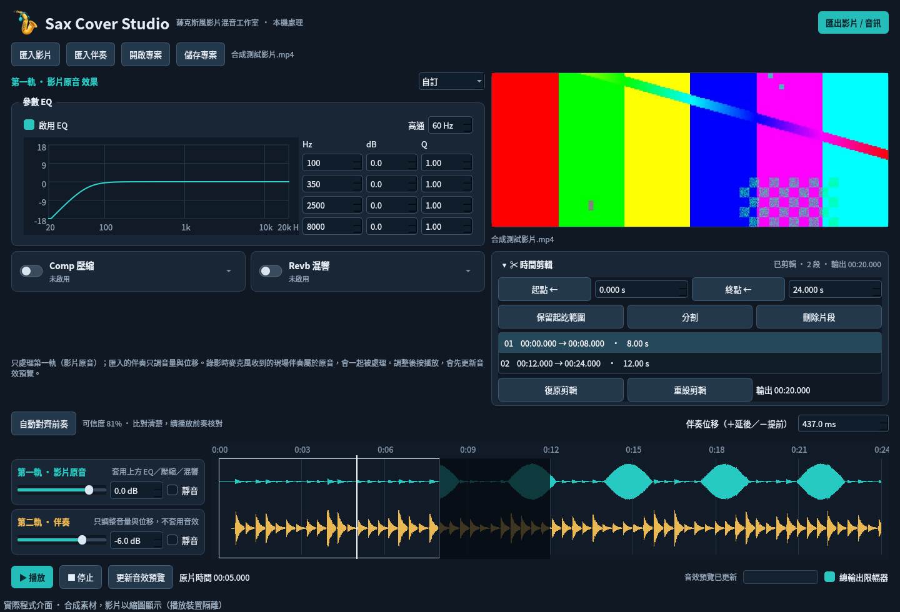
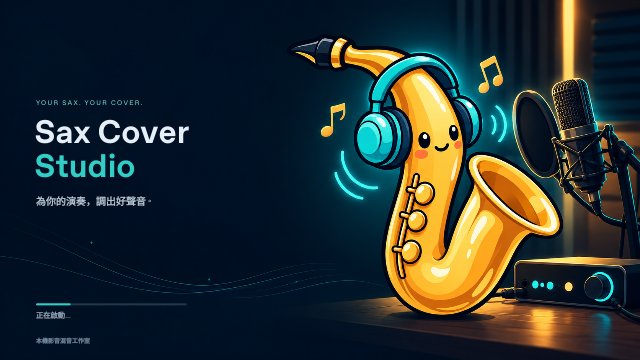

# Sax Cover Studio — 薩克斯風影片混音工作室（Windows 11／macOS Apple Silicon）

**Beta V0.7** · 作者：Rex Mu | RexFactory。所有影音處理都在本機執行。繁體中文 Qt 桌面介面，採用 FFmpeg 進行解碼、音效與輸出。
**本次已驗證 Linux 的音訊／剪輯引擎與 Qt5 介面。新版 Qt6／Win11 播放、工作列圖示與 EXE 安裝仍需實機驗證；此交付包為原始碼，不包含預先建置的 Windows EXE。**



## Beta V0.7 更新：中途重錄

- **從這裡重錄到結尾**：錄完後在時間軸點選起點（播放頭位置），按錄音面板的「從 mm:ss 重錄到結尾」。起點前 3 秒先播放伴奏與目前的錄音讓你銜接，到起點才開始錄；按停止或伴奏播完結束，起點之後換成新錄音，接縫自動做 20 ms 交叉淡化並套用延遲補償。
- 可重錄任意次數，也可以從前一次重錄的中間再重錄；「復原上一次重錄」可一路復原。每次重錄另存檔案（約每分鐘 11 MB），存在「文件／Sax Cover Studio／錄音」。
- **第一軌分色**：原始錄音青色，第 1、2、3… 次重錄依序橘、紫、粉紅、綠、藍（循環）；滑鼠停在波形上顯示是哪一次重錄。只在軟體中顯示，匯出不受影響。
- **錄音設定折疊**：輸入裝置、聲道、耳機輸出、倒數、伴奏音量、延遲補償收進「⚙ 錄音設定」，收合時顯示一行摘要；第一次使用自動展開，之後記住；錄音中自動收合。

## Beta V0.6 更新

- **調整設定後接著播放**：播放中改 EQ／壓縮／混響等設定，停手約 0.6 秒後自動重新計算，並從剛才聽到的位置繼續播放（不再從頭開始）。
- **輸入音量表**：-12 dB 以下綠色、-12～-4 dB 黃色、-4 dB 以上紅色；峰值落在 -12～-6 dB 最理想。旁邊顯示最近 3 秒峰值，方便對照錄音介面燈號。
- **破音判斷**：連續 3 個取樣達到滿刻度才算破音，單一尖峰不再誤判。若軟體顯示破音但錄音介面燈號未亮，請檢查 Windows 錄音裝置音量是否為 100、是否開啟音訊增強。
- **GitHub 自動打包 Windows 安裝檔**（`.github/workflows/build-windows.yml`）；修正雲端打包時開機畫面中文變成方框。

## Beta V0.5 更新：Mac 版（M 系列）

- 新增 **macOS Apple Silicon（M1／M2／M3／M4…）** 打包：在 Mac 上執行一個指令即可產生 `Sax Cover Studio.app` 與 `.dmg`。
- **FFmpeg／FFprobe 打包時自動下載**（固定 9.0.2 版、Martin Riedl 的已簽署 arm64 版本），並以官方 SHA256 與 `tools/ffmpeg-macos-arm64.lock` 雙重驗證；`tools/` 已有檔案就不重新下載。
- **麥克風權限**：錄音模式第一次開啟時 macOS 會詢問；若拒絕，錄音面板會說明到「系統設定 → 隱私權與安全性 → 麥克風」開啟。
- 介面字型在 Mac 使用蘋方（PingFang TC）。Mac 版不顯示 PyInstaller 開機圖（Windows 專用），仍會顯示程式內的啟動畫面與讀取進度。
- Windows 版建置方式不變。

## Beta V0.4 更新

- **時間剪輯改為浮動視窗**：主畫面右側只保留影片預覽；按對齊列最左邊的「✂ 時間剪輯…」開啟視窗，旁邊顯示目前剪輯摘要。
  - 視窗內有影片預覽（顯示游標位置的畫面）、播放與前後一格、起點／終點、保留起訖範圍、分割（Ctrl+B）、刪除片段、依伴奏自動裁剪與前後秒數、保留片段清單。
  - 下方是可縮放（1×～8×）的雙軌波形，播放時游標保持在畫面內。
  - 「完成」保留這次的剪輯；「取消」或關閉視窗會還原到開啟前的狀態。
- **功能說明**：工具列「重設版面」與「關於」之間新增，內容為軟體介紹與功能一覽（文字在 `saxstudio/help_text.py`）。
- **米黃亮色主題**：標題列右側的切換鈕可在暗色與米黃亮色之間切換，波形、EQ 曲線、開關與音量表一起換色，下次開啟會記住。

## Beta V0.3 更新：錄音模式

- 按「新專案」選擇 **匯入影片** 或 **錄音**。模式在建立專案時決定，工具列只顯示目前模式；要換模式請開新專案。
- **錄音模式**：先匯入伴奏，選擇錄音介面的輸入裝置、輸入聲道與耳機輸出，戴耳機邊聽伴奏邊錄。
  - 輸入音量表（-60～0 dB，峰值保持）與破音警告；可調整耳機裡的伴奏音量；開始前倒數 3／5 秒或關閉。
  - 伴奏播完 2 秒後自動停止，也可隨時按停止。錄音邊錄邊寫入硬碟（每 0.5 秒更新檔頭），程式意外關閉也保留已錄部分。
  - 錄音檔存放在「文件\Sax Cover Studio\錄音」，48 kHz／32-bit 浮點／單聲道 WAV。
  - 錄完自動放進第一軌，伴奏位移由錄音時間自動計算並扣除延遲；仍可手動微調。
  - **重錄（取代這次錄音）**：伴奏、EQ／壓縮／混響、音量與延遲校正全部保留，只換掉錄音。
  - 錄音模式匯出 WAV／MP3（沒有畫面，不提供 MP4）。
- **延遲校正**：把耳機放在麥克風前，程式播放 8 聲節拍並量測往返延遲，依「輸入裝置＋輸出裝置」組合記住。建議使用有線耳機；藍牙耳機延遲大且不固定。
- 第一次錄音時 Windows 可能詢問麥克風權限；若被拒絕，請到「設定 → 隱私權與安全性 → 麥克風」允許桌面應用程式存取。

## Beta V0.2 更新

- 版本改為 Beta 編號：V0.2 起每版加 0.1（V0.9 之後為 V0.10、V0.11…，直到正式版）。標題列、主畫面、啟動畫面、「關於」視窗與安裝程式顯示版本及作者。
- **雙擊立即出現開頭畫面**：EXE 一啟動就由打包程式顯示靜態開頭畫面，接著由程式內的畫面接手並顯示讀取進度（音訊引擎 → 主畫面 → FFmpeg 檢查）。需要 Python 的 Tcl/Tk（python.org 安裝程式預設包含）。
- 三個主要區塊可拖曳分隔線調整大小，會記住調整結果；工具列「重設版面」恢復預設。影片預覽預設較小，效果區較大。
- EQ 也改為折疊卡片（與 Comp／Revb 相同的滑動開關與展開箭頭），新專案預設關閉。
- EQ／Comp／Revb 標題旁的 ⓘ：點一下顯示各參數的作用與薩克斯風調整建議（文字在 `saxstudio/help_text.py`）。
- 快速音色改為按鈕列；手動調整後顯示「自訂」。「↶ 還原套用前設定」可回到套用快速音色之前的設定。
- **依伴奏自動裁剪**：對齊伴奏後，按「依伴奏自動裁剪」，以伴奏實際有聲音的範圍為準（略過檔案前後靜音與聽不到的淡出尾巴），保留伴奏開始前 3 秒到結束後 2 秒，其餘剪掉。秒數可在時間剪輯區調整；可用「復原剪輯」撤回；對齊可信度偏低時會先詢問。
- 數字欄的上下按鈕加上箭頭圖示。

## 0.1.2 更新

- 新名稱 **Sax Cover Studio**，採用戴耳機的可愛薩克斯風角色。
- 包含 16／20／24／32／40／48／64／96／128／256 px 的透明 ICO；應用程式、視窗、PyInstaller EXE、安裝程式與捷徑使用同一圖示。
- 啟動時顯示角色插畫，初始化後自動進入主介面。
- Comp／Revb 改為折疊卡片：左側滑動開關控制啟用，右側箭頭只控制展開／收合。新專案預設關閉並收合；展開不啟用，收合不關閉，也不清除參數。
- 舊 `.saxproj` 仍可開啟，沿用儲存的開關與參數；原音色預設保持 0.1.1 的效果行為。
- 0.1.1 的音訊引擎、對齊、FFmpeg 檢查、剪輯與輸出程式逐檔保持原樣。詳見 [版本紀錄](docs/CHANGELOG.md)。



## 已實作

- 影片與伴奏匯入、雙軌波形、各自的音量（−60 至 +12 dB）與靜音。
- 比對前 90 秒的頻譜特徵，自動估算伴奏位移；以前奏波形細調，顯示相似度與模糊比對提示。位移可手動調整至 0.1 ms。
- 第一軌（影片原音）的四段參數 EQ、可關閉高通、壓縮器（門檻／比例／啟動／釋放／補償）、立體聲卷積混響（乾濕／RT60／預延遲）。第二軌（匯入的伴奏）只調整音量與位移，不套用這些效果。
- 兩軌混音後的總輸出限幅器，峰值限制 −1 dBFS（保留 AAC／MP3 編碼的峰值餘裕）；可關閉。音色預設不會改變限幅器開關。
- 快速音色按鈕：自然乾聲、溫暖薩克斯風、明亮獨奏、柔和空間；可還原套用前的設定。
- 依伴奏自動裁剪：保留伴奏有聲範圍前 3 秒、後 2 秒（可調整）。
- 預覽播放、暫停、停止及游標定位。音效或音量變更後，先渲染暫存混音，再播放；預覽與匯出共用同一套音效。
- 非破壞性時間剪輯（剪輯區預設收合，標題列顯示剪輯摘要；按 `Ctrl+B` 分割時自動展開）：設定起訖、保留範圍、分割、刪除選取片段、復原與重設。影片與伴奏同步剪輯，匯出時接合保留片段。
- JSON `.saxproj` 專案儲存／開啟，保存原檔路徑、位移、音效、音量及保留片段。
- 匯出 MP4、24-bit WAV、320 kbps MP3。背景處理與取消作業；輸出成功前不覆蓋既有成品，不允許覆蓋原始影音。

## 檔案格式

| 類型 | 支援範圍 |
|---|---|
| 影片匯入 | MP4、MOV、MKV、AVI、WebM；實際以 FFmpeg 能解碼的串流為準 |
| 常見影像編碼 | H.264、H.265／HEVC、VP8／VP9，取決於所選 FFmpeg build |
| 伴奏匯入 | MP3、WAV、FLAC、M4A、AAC、OGG |
| 影片輸出 | MP4：H.264、AAC 256 kbps、30 fps、原畫面尺寸（奇數尺寸會向下調成偶數） |
| 音訊輸出 | WAV：48 kHz／24-bit stereo；MP3：48 kHz／320 kbps stereo |

輸入使用原檔時間戳，輸出轉成固定 30 fps；影片時間剪輯精度受影格限制，音訊採樣精度為 48 kHz。
Qt 的影片預覽與 FFmpeg 的匯出是不同解碼路徑；特殊編碼可能能匯出但不能在 Qt 預覽，需用實際 Win11 檔案驗證。
不包含 HDR 色調映射：第一版請使用 SDR 錄影；HDR／Dolby Vision 成品的色彩可能不正確。

## Windows 11 建置與執行

1. 安裝 **Python 3.12，64 位元**（含 Python Launcher `py`）。
2. 從 [FFmpeg 官方下載頁](https://ffmpeg.org/download.html#build-windows) 選擇 **7.1 或更新版** 的 Windows 64 位元完整 static build。
3. 將 `ffmpeg.exe`、`ffprobe.exe` 放進 `tools/`，並保留該版本授權／來源資料；詳見 [tools/README.md](tools/README.md)。
4. **雙擊專案根目錄的 `build-windows.cmd`**，或在同一資料夾開啟 PowerShell 執行：

```powershell
powershell -ExecutionPolicy Bypass -File .\scripts\build-windows.ps1
```

程式啟動時會檢查 FFmpeg 版本（需 7.1 以上）與必要的濾鏡／編碼器，不符合時會提示。

腳本建立 `.venv`、安裝依賴、跑功能測試、打包。結果是 **`dist\SaxCoverStudio\SaxCoverStudio.exe`**；整個 `SaxCoverStudio` 資料夾需一起保留。成品在使用時不需要 Python、網路或獨立安裝 FFmpeg。
請保留整個輸出資料夾，不能只複製 EXE。若從舊版升級，可把舊資料夾中的 `tools\ffmpeg.exe`／`ffprobe.exe` 複製到新版的 `tools`；來源錄影與 `.saxproj` 不必更改。

要做可安裝的 EXE，另外安裝 **Inno Setup 6.3 或更新版本**，雙擊根目錄的 `build-installer.cmd`，或執行：

```powershell
powershell -ExecutionPolicy Bypass -File .\scripts\build-windows.ps1 -Installer
```

輸出：**`dist\installer\SaxCoverStudio-Setup-BetaV0.4.exe`**。採用每位使用者安裝，不要求系統管理員權限；提供開始功能表捷徑及解除安裝。
目前沒有程式碼簽章；正式對外分發前需完成 Win11 安裝／播放測試及依賴授權資料整理。

開發模式：

```powershell
.\.venv\Scripts\python.exe run.py
```

或執行 `scripts\start-windows.cmd`。第一次安裝套件需要網路，執行程式不需要。

若從舊版升級後，工作列仍顯示舊捷徑／圖示，請取消釘選舊版，再從新版本的捷徑重新釘選。

## macOS（Apple Silicon）建置

只支援 M 系列 Mac（arm64），macOS 12 以上。

1. 從 <https://www.python.org/downloads/macos/> 安裝 **Python 3.12**（官方安裝檔）。
2. 解壓原始碼，在 Finder 雙擊 **`build-mac.command`**；或在「終端機」進入資料夾後執行：
   ```bash
   bash scripts/build-mac.sh
   ```
   第一次需要網路（下載 Python 套件與 FFmpeg）。腳本會依序：建立 `.venv-mac`、安裝套件、下載並驗證 FFmpeg、執行功能測試、產生圖示、打包並做 ad-hoc 簽章、製作 dmg。
3. 輸出：
   - `dist/Sax Cover Studio.app`
   - `dist/SaxCoverStudio-BetaV0.7-macOS-AppleSilicon.dmg`
4. 安裝：打開 dmg，把 App 拖到「應用程式」。**第一次開啟請在 App 上按右鍵 →「打開」**（App 沒有 Apple 開發者簽章與公證，直接雙擊會被 Gatekeeper 擋下）。若仍被擋，到「系統設定 → 隱私權與安全性」按「仍要打開」。

FFmpeg 相關：
- 版本與下載位置在 `tools/ffmpeg-macos-arm64.env`。第一次下載成功會寫入 `tools/ffmpeg-macos-arm64.lock`（SHA256）；之後檔案若改變會停止打包。**刻意升級 FFmpeg 時**：修改 env、刪除 lock，再以 `FORCE=1 bash scripts/fetch-ffmpeg-mac.sh` 重新下載。
- 想用自己的 FFmpeg：把 `ffmpeg`、`ffprobe`（arm64）放進 `tools/`，腳本就會略過下載。
- 授權說明自動寫入 `tools/licenses/BUILD.txt` 並打包進 App。

## 操作

1. 按「匯入影片」，再「匯入伴奏」。影片必須包含可解碼的原音，伴奏應為錄音時使用的同一版本。
2. 按「自動對齊前奏」。正位移表示 MP3 延後播放，負位移表示提前。顯示的可信度是頻譜相似度，**不是準確率的機率**。
3. 想只保留演奏範圍時，按「依伴奏自動裁剪」：保留伴奏開始前 3 秒到結束後 2 秒（秒數可在時間剪輯區調整，可用「復原剪輯」撤回）。
   按播放核對前奏，也核對結尾。調整「伴奏位移」可處理剩餘誤差。錄音中伴奏很小、前奏靜音、版本不同或伴奏重複段落，都可能使自動對齊不可靠。
4. 調整雙軌音量與第一軌音效。EQ／Comp／Revb 預設關閉；點 ⓘ 可看各參數說明；左側滑動開關啟用效果，右側箭頭展開參數。關閉的效果仍保留原數值；需要修改時先啟用。按「更新音效預覽」或播放會先產生暫存 WAV；第一版不是邊拖旋鈕邊即時 DSP，處理期間可取消。
5. 時間軸點擊可定位、選取片段。用「起點／終點」抓取游標時間或直接輸入秒數，再按「保留起訖範圍」。刪除中段則先在兩端分割、選取中間片段後刪除。`Ctrl+B` 分割，`Ctrl+Z` 復原剪輯。
6. 儲存專案 `Ctrl+S`。專案不內嵌原始影音，請保留來源檔案在原位置。
7. 按「匯出影片 / 音訊」選擇格式。匯出會重新套用最新設定，並接合所有保留片段。

暫停時點擊時間軸會顯示該位置的實際畫面。預覽播放以混音音訊為主時鐘，畫面落後超過 150 ms 時才校正畫面。

時間軸與游標顯示的是**原始影片時間**，右側另顯示剪輯後輸出長度。預覽會跳過刪除區段，跨剪輯點可能有短暫播放器 seek 等待；匯出則接合片段。
輸出電平條是經降採樣的單聲道近似峰值，不是 LUFS 或 true-peak 儀表。

## 目前限制

- EQ／壓縮／混響只作用於影片原音；原音中已收錄的伴奏和房間聲會一起被處理，無法單獨調低。未加入 AI 音源分離。
- 只估計固定時間位移，尚未做長錄音時鐘漂移校正。開頭與結尾若不同步，第一版無法自動修正。
- 輸出會重新編碼；不做畫面裁切、多機位、字幕、變速、轉場或剪輯交叉淡化。剪輯點若切在聲音中，可能聽到突變，建議切在安靜位置。
- 未使用 GPU 加速；長影片、高解析度影片及多段剪輯需較多時間／暫存空間，卷積音訊暫存約每分鐘 23 MB。
- 還沒有實際麥克風演奏樣本可驗證；測試使用已知位移、音色變化與噪音的合成音訊，不能代替真實錄音驗證。
- Mac 版只支援 Apple Silicon，未經 Apple 公證；Mac 打包、麥克風權限與錄音延遲尚未在實機驗證。專案檔若在 Windows 與 Mac 之間互換，媒體檔路徑需重新指定。
- 專案路徑失效時目前提示原路徑，需移回原檔或手動更新 `.saxproj` 中的路徑。

## 開發驗證

```bash
python -m unittest discover -s tests -p 'test_core.py' -v
```

功能測試涵蓋正／負位移、低音量伴奏與麥克風音色變化、不相干／靜音音訊、各軌音量、EQ、壓縮、混響、限幅、同步刪除中段後 MP4／WAV／MP3 的長度及音訊位置與影片影像位置、合成可變影格率輸入、來源保護、取消與專案驗證。詳見 [驗證紀錄](docs/VALIDATION.md)。

Linux 離線介面相容檢查可用系統 PyQt5；Windows 成品使用 PySide6，不需要 PyQt5。UI 測試：

```bash
QT_QPA_PLATFORM=offscreen python -m unittest discover -s tests -p 'test_ui.py' -v
```

Windows 實機驗收還需檢查：H.264／HEVC／MOV 實際檔案、外接麥克風錄音對齊、預覽聲畫同步、調整效果、剪輯接合、長片效能、安裝／解除安裝、非 ASCII 路徑。
